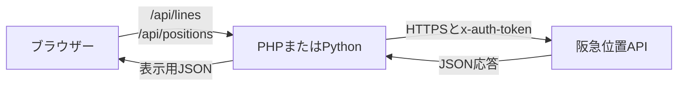

# 阪急沿線アプリ: 車両位置のAPK・Web API解析

阪急沿線アプリが車両位置を表示する経路を、APKのクラス、WebViewへ配信されるJavaScript、実際に返ったJSONの順に説明します。対象はAndroidパッケージ `jp.co.hankyu.tokkapp`、versionName `10.3.3`、versionCode `98` です。XAPKメタデータでは、Android 9以降（API 28）が対象になっています。 JADXの解析結果では、車両位置画面の `TrainPositionFragment` はbase APKの `classes3.dex` にあります。

ここで使うAPIのURLとJSON項目は観測した時点のものです。阪急がWeb開発者向けに公開している契約済みAPI仕様書ではありません。

## APK内で見つかるもの

XAPKは複数のAPKと配布メタデータをまとめる形式です。base APKにアプリコードがあり、別のsplit APKにCPU構成、言語、画面密度に応じた資源があります。今回はbase APKから3つのDEXを逆コンパイルして読みました。JADX 1.5.6がJavaに近い形で表示しますが、出力は元のKotlinソースそのものではありません。 [JADX](https://github.com/skylot/jadx)

車両位置を追うときの主なクラス名と役割は次の通りです。

| APK内のクラス | 内容 |
| --- | --- |
| `jp.co.hankyu.tokkapp.presentation.stationinfo.TrainPositionFragment` | 車両位置画面を表示するWebView URLを作ります。 |
| `jp.co.hankyu.tokkapp.presentation.stationinfo.TrainPositionFragmentArgs` | 画面遷移で受け取る `trainPositionLineId` と `stationId` を提供します。 |
| `jp.co.hankyu.data.BuildConfig` | アプリ共通のベースURLと認証用の文字列定数を持ちます。 |
| `jp.co.hankyu.data.remote.AppApiService` | Retrofitで使う一般APIを定義し、注釈で `x-auth-token` ヘッダーを指定します。 |
| `jp.co.hankyu.data.remote.entity.CurrentInfoPositionEntity` | 駅情報に付随する現在情報を表します。車両位置APIの `positions[]` とは別のデータモデルです。 |

### `TrainPositionFragment.onViewCreated()`

`onViewCreated(View, Bundle)` は `https://cdn.hankyu-app.com/webview/train/position` を基点にAndroidの `Uri.Builder` を使い、画面を開きます。ここへ次のクエリを加えてから `loadUrl()` を呼びます。

| クエリ | 値の取得元 | 役割 |
| --- | --- | --- |
| `token` | `BuildConfig.APP_AUTH_TOKEN` と同じアプリ共通値 | WebView側のAPIクライアントへ渡す認証情報 |
| `dtype` | `DeviceType.ANDROID.getParam()` | アプリ画面の端末種別 |
| `line_id` | `TrainPositionFragmentArgs.getTrainPositionLineId()` | 最初に表示する路線 |
| `station_id` | `TrainPositionFragmentArgs.getStationId()` | 画面の初期スクロール先 |

同じURLの組み立ては `onHiddenChanged(boolean)` にもあります。画面を再び表示したとき、現在の引数でWebViewを読み込み直します。

### `BuildConfig` と認証ヘッダー

`jp.co.hankyu.data.BuildConfig` には、`APP_BASE_URL = "https://cdn.hankyu-app.com"` と `APP_AUTH_TOKEN` が定数としてあります。値はAPK内の固定文字列で、利用者のログインセッションや個人ごとに発行されるアクセストークンではありません。

`AppApiService` の各Retrofit定義には `@Headers("x-auth-token: …")` が付いています。これは駅、時刻表、お知らせなど一般APIのヘッダー指定です。車両位置画面の `train/positions` 呼び出しは、このRetrofitメソッドとしてではなく、次に述べるWebView側のJavaScriptから行われます。両方が同じ共通認証値を参照することを照合できます。

`CurrentInfoPositionEntity` は別の注意点です。DEX内のJSON注釈が示す項目は `time_real`、`stop_index`、`prev_index` です。これは駅情報に付随する現在情報であり、下記の車両配列の列車モデルへ混ぜて解釈する項目ではありません。

## WebViewのJavaScriptが位置を取得する

WebViewの入口HTMLはNuxtアプリを読み込みます。確認した共通コードでは、Axiosの既定ベースURLが次でした。

```text
https://cdn.hankyu-app.com/v1/
```

WebViewの路線状態は `setParameters()` でURLクエリの `token` を読み、APIクライアントに `x-auth-token` として設定します。車両位置ストアの `fetchTrainPositions(lineId)` は、そのベースURLに対して次のGETを行い、応答を位置データと状態に保存します。

```http
GET https://cdn.hankyu-app.com/v1/train/positions/?train_position_line_id=1
x-auth-token: <APKに含まれるアプリ共通トークン>
Accept: application/json
```

`dtype`、`station_id` と `token` はWebViewの初期画面を構成するパラメーターです。位置APIのクエリは `train_position_line_id` です。独自サーバーでは、短い `line_id` を受け取り、この上流クエリ名に変換しています。

## WebViewが使う停車・走行判定

車両位置画面のコンポーネントは概ね次の条件で応答を分けます。

- `getPositionsStopping(stationId)` は `from_station` が駅IDと一致し、`to_station` が `null` の位置を停車中とみなします。
- `getPositionsRunning(stationId)` は `to_station` が `null` ではない列車を走行中とみなします。`direction === 0` の場合は `from_station`、それ以外の場合は `to_station` を画面上の駅間の対応付けに使います。
- `state` が `finished` のときは営業時間外、`under_maintenance` のときはメンテナンスとして案内を出します。

駅間の位置を表示するために、APIの整数IDが連番かどうかだけでは判断できません。路線ごとの駅配列を使い、列車の `from_station` と `to_station` の並び順を照合します。

## 位置APIが返すJSON

最上位はオブジェクトで、`timestamp`、`state`、`positions` の3項目が観測されています。

```json
{
  "timestamp": "2026-10-10T22:10:50",
  "state": "normal",
  "positions": [
    {
      "operation_number": "8203",
      "destination": "新開地",
      "from_station": 1,
      "from_station_name": "大阪梅田",
      "to_station": null,
      "to_station_name": null,
      "line_destination_id": 33,
      "delay": 0,
      "is_display_delay": true,
      "train_kind_key": "semi_limited_express",
      "train_kind_name": "準特急",
      "direction": 1,
      "track_number": 9,
      "is_edge_station": true
    }
  ]
}
```

これは15列車が返った時点の実応答から1件を抜き出した形式例です。[JSON例](api-response-example.json)にも同じ応答を置いています。現在運行中かは取得時刻によって変わります。

| JSON項目 | 観測した意味 |
| --- | --- |
| `timestamp` | 位置データの時刻。例ではタイムゾーンの接尾辞がありません。 |
| `state` | `normal`、`finished`、`under_maintenance` などの配信状態です。 |
| `positions` | 列車の配列です。配列が空の場合は、それだけでエラーや営業時間外とは判断できません。 |
| `operation_number` | 運行番号です。車両編成番号とは別の値です。 |
| `destination`、`line_destination_id` | 行先名と行先の識別IDです。 |
| `from_station`、`from_station_name` | 停車駅、または走行区間の駅情報です。 |
| `to_station`、`to_station_name` | 走行区間の相手側駅です。停車中の応答では `null` が観測されています。 |
| `train_kind_key`、`train_kind_name` | 列車種別の識別子と表示名です。 |
| `direction` | 方向コードです。駅IDや行先を照合できないときの補助にします。 |
| `delay`、`is_display_delay` | 遅延に関する数値と表示フラグです。丸め方など、全条件は確定していません。 |
| `track_number`、`is_edge_station` | 番線と端点に関する値です。 |

配信状態 `finished` の応答例は `positions: []` でした。UIでは状態と配列件数を別に確認し、営業時間外やメンテナンスと、単に列車が表示されない応答を区別します。到着見込み時刻は、確認した位置JSONにはありませんでした。画面で到着時刻を独自計算する機能もありません。

## 路線IDと駅データ

WebViewの路線画面には路線IDと順序付き駅一覧があります。これを路線データとしてまとめ、駅ID、駅名、かなを使って列車位置を路線図へ対応付けます。観測した路線IDと駅数は次の通りです。

| 路線ID | 路線 | 駅数 |
| --- | --- | ---: |
| 1 | 神戸本線 | 17 |
| 2 | 宝塚本線 | 19 |
| 3 | 京都本線 | 28 |
| 4 | 今津線（今津〜西宮北口） | 3 |
| 5 | 今津線（西宮北口〜宝塚） | 8 |
| 6 | 伊丹線 | 4 |
| 7 | 甲陽線 | 3 |
| 8 | 箕面線 | 4 |
| 9 | 千里線 | 10 |
| 10 | 嵐山線 | 4 |

駅IDの大小と駅順は同じものではありません。方向を知るには、対象路線の配列位置を比べます。APIの行先が表示範囲より先の駅でも、行先名は列車カードに表示できます。

## 進行方向の表示

順序付き駅一覧に対し、 `to_station` が `from_station` より後なら末尾側、前なら先頭側へ進んでいると表示します。停車中の列車は現在駅と路線内の行先駅を比べます。それらから方向を決められない場合に限り `direction` を補助値として使います。路線1の走行中の実応答で `direction` 0と1の事例を、APIの出発駅・次駅が示す配列方向と照合しました。行先が路線外の終着駅の場合など、曖昧さが残る情報から矢印を断定せず「方向不明」とします。

路線図の矢印は駅配列の先頭側と末尾側を示します。鉄道の公式な「上り」「下り」がすべての支線で同じ向きとは限りません。駅間として見せられるのは、出発側・到着側の両駅が路線図の隣り合う駅として一致した場合です。座標や実距離を使った線路上の精密な位置は表しません。

## Web版の通信とCORS



ブラウザーはページと同じ配信元にある自作APIを使います。阪急APIへブラウザーから直接アクセスしないため、上流APIのCORS許可には依存しません。自作APIを別の配信元から呼び出す場合は、その配信元のCORS設定が別途必要です。

Python版はサーバー側から位置を取得してJSONを返します。PHP版も同じ処理を行い、成功時は阪急APIの生レスポンスを取得日時と路線ごとに保存し、APIリクエストの記録を日付単位で追加します。保存データはHTTPから参照できない場所に置きます。いずれの実装もブラウザー用JavaScriptへ認証値を埋め込みません。

## 認証情報の種類と有効期間

APK内の値はアプリ共通の固定トークンです。個人ログイン、更新トークン、利用者ごとのセッションではありません。逆コンパイル結果では、ネイティブコードの定数とWebViewへ渡す `token` が一致し、WebViewがこれを `x-auth-token` に設定していました。

固定値であることから期限を推定することはできません。2026年10月10日の確認時にはHTTP 200の応答がありましたが、阪急側が値やAPIを変更すると、同じ値で動作しなくなる可能性があります。配信元や認証が変更された場合は、改めて現行アプリと配信JavaScriptを確認してください。

## 調査方法を再現する

1. XAPKの `manifest.json` から `package_name`、`version_name`、`version_code` を調べます。
2. base APKをJADXで読み込み、`TrainPositionFragment` の `onViewCreated` と `onHiddenChanged` を探します。
3. `BuildConfig`、`AppApiService`、`TrainPositionFragmentArgs` の注釈・定数・引数を照合します。
4. WebView URLを読み込み、HTMLが参照するJavaScriptと、画面遷移で追加ロードされるチャンクを追います。
5. APIクライアントのベースURL、トークン設定、`fetchTrainPositions`、路線画面の停車／走行判定を確認します。
6. 観測した認証付きGETをサーバー側から行い、複数路線と異なる `state` のJSON形状を記録します。
7. 対象JSONの `from_station`、`to_station` を順序付き路線データと照合し、駅停車と駅間走行、方向表示を確認します。

JADXの出力は「ソースコードと一致する正式版」とは限りません。Java/Kotlinの元コードではなく、逆コンパイルで再構成された制御構造とAndroid APIの用途を合わせて読みます。

## Unlicenseと第三者コンテンツ

このWebアプリのために書かれたコードと解説は、[Unlicense](../LICENSE) によりパブリックドメインとして扱えるよう公開しています。阪急沿線アプリ、APKから得られた内容、会社名・ロゴ、APIデータ、列車位置の応答例などの第三者コンテンツに、このライセンスから新しい権利が生じるわけではありません。アプリ共通トークンも、その値を利用するAPIの権利・利用条件を付与するライセンスではありません。

この再現アプリは阪急電鉄の公式サービスではありません。運行の確認には[阪急電鉄 運行情報](https://www.hankyu.co.jp/railinfo/)を利用してください。
